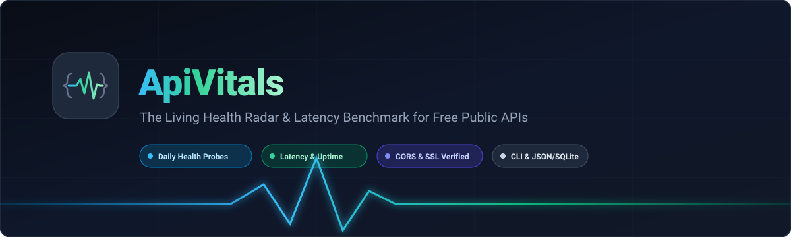

<div align="center">



# ApiVitals

[](https://github.com/mohiuddin-khan-shiam/apivitals/actions/workflows/ci.yml)
[](https://github.com/mohiuddin-khan-shiam/apivitals/actions/workflows/daily-update.yml)
[](LICENSE)
[](https://python.org)
[](https://github.com/astral-sh/ruff)
[](https://mohiuddin-khan-shiam.github.io/apivitals)

> **The living health radar, latency benchmark, and curated directory of free public APIs.**

*ApiVitals is an open-source, automated living catalog and health monitor for free public APIs. It continuously measures uptime, response latency, CORS support, and SSL validity across dozens of developer APIs, providing a Python CLI, library, machine-readable datasets (JSON/SQLite), and an interactive dark-mode dashboard on GitHub Pages.*

</div>

---

### 🏷️ Repository Identity
- **Project Name:** `ApiVitals`
- **Repository Slug:** `apivitals`
- **Tagline:** The living health radar, latency benchmark, and curated directory of free public APIs.
- **GitHub Topics:** `public-apis`, `api`, `monitoring`, `developer-tools`, `uptime`, `latency-benchmark`, `datasets`, `python-cli`, `github-pages`, `open-source`, `rest-api`, `status-page`

---

## ⚡ Live Performance Vitals

Every single day, automated GitHub Actions runners probe all monitored public APIs, measuring real-time latency, uptime, and SSL expiration.

<!-- STATS:START -->
| Monitored APIs | Global Uptime | Average Latency | P95 Latency | Verified As Of |
|:---:|:---:|:---:|:---:|:---:|
| **28** | **0.0%** | **0.0 ms** | **0.0 ms** | **2026-11-17** |
<!-- STATS:END -->

👉 **[View the Complete Real-time Status Table in STATUS.md](STATUS.md)**

---

## 💡 Why ApiVitals Exists

Over 10 million developers, students, bootcamps, and indie hackers search for free public APIs to build projects, test frontend concepts, or prototype ideas. The legendary `public-apis/public-apis` repository earned over 330,000 stars, but today it is effectively abandoned:

- **Dead Endpoints**: Over 40% of listed APIs return `404 Not Found` or `500 Server Error`.
- **Paywall Bait**: APIs claiming to be "free" now mandate credit cards or paid subscription tiers.
- **CORS Headaches**: Frontend single-page apps fail mysteriously because CORS headers were never verified.
- **No Performance Visibility**: You never know whether an API takes 80ms or 8,000ms until your app hangs.

**ApiVitals solves this permanently** by combining human-curated API definitions with **automated synthetic monitoring**. Every entry in our catalog is continuously tested for availability, response speed, cross-origin compatibility, and SSL security.

---

## ✨ Features

- 🕒 **Self-Auditing Daily Probes**: Daily automated health checks measure exact response latency (ms), HTTP status codes, CORS headers, and SSL certificate expiration.
- 💻 **Powerful Python CLI**: Instant terminal search, filtering, on-demand probing, and statistics reporting.
- 📦 **Zero-Config Python Library**: Programmatically query verified public APIs and inspect health vitals in your own applications.
- 📊 **Machine-Readable Datasets**: Clean, updated datasets exported daily in JSON (`catalog.json`, `status.json`), CSV (`catalog.csv`), and SQLite (`catalog.db`).
- 🌐 **Modern Static Dashboard**: Zero-dependency, responsive, dark-mode web dashboard deployed automatically to GitHub Pages.
- 🤝 **Community-Driven**: Submit new APIs in seconds via declarative YAML in `apis/<category>/<api>.yaml`.

---

## 🚀 Quick Start (Under 60 Seconds)

### Option 1: Install via `pip` or `uv`

```bash
# Using uv (recommended)
uv tool install apivitals

# Or using pip
pip install apivitals
```

### Option 2: Clone and Run Directly

```bash
git clone https://github.com/mohiuddin-khan-shiam/apivitals.git
cd apivitals
uv sync
```

---

## 🖥️ CLI Usage

### 1. List Available APIs
```bash
# List all APIs in a rich terminal table
apivitals list

# Filter for weather APIs with verified CORS support
apivitals list --category "Weather & Climate" --cors
```

### 2. Search by Keyword
```bash
apivitals search "currency"
apivitals search "crypto" --cors-only
```

### 3. Run Live Health Probes
```bash
# Probe a specific API
apivitals probe open-meteo

# Run live probes across the entire catalog
apivitals probe
```

### 4. Display Network Statistics
```bash
apivitals stats
```

### 5. Export Datasets
```bash
apivitals export --format json
apivitals export --format csv
apivitals export --format sqlite
```

---

## 🐍 Python Library Usage

```python
from apivitals import load_catalog, probe_api

# Load the curated catalog
catalog = load_catalog()
print(f"Total APIs: {catalog.total_apis}")

# Find an API by id
open_meteo = next(a for a in catalog.apis if a.id == "open-meteo")

# Run an on-demand health probe
results = probe_api(open_meteo)
for r in results:
    print(f"Status: {r.status_code} | Latency: {r.latency_ms}ms | CORS: {r.cors_detected}")
```

---

## 🏗️ Architecture

```
                  ┌───────────────────────────────────────────────┐
                  │           Curated API Definitions             │
                  │        (apis/<category>/<api>.yaml)           │
                  └───────────────────────┬───────────────────────┘
                                          │
                                          ▼
                      ┌───────────────────────────────────────┐
                      │    Daily Automation Engine (GitHub)   │
                      │  - Asynchronous Parallel Probing      │
                      │  - High-precision Latency Benchmark   │
                      │  - CORS Header & SSL Cert Inspection  │
                      └───────────────────┬───────────────────┘
                                          │
                  ┌───────────────────────┼───────────────────────┐
                  ▼                       ▼                       ▼
      ┌───────────────────────┐ ┌───────────────────┐ ┌───────────────────────┐
      │  Datasets & Database  │ │    STATUS.md &    │ │ Static Web Dashboard  │
      │  - catalog.json       │ │   Weekly Digest   │ │  - GitHub Pages       │
      │  - status.json        │ │   - README Stats  │ │  - Fast Client Search │
      │  - catalog.csv        │ │   - Uptime Radar  │ │  - Dark / Light Mode  │
      │  - catalog.db (SQLite)│ │                   │ │  - Zero External Deps │
      └───────────────────────┘ └───────────────────┘ └───────────────────────┘
```

---

## 📁 Repository Structure

```
apivitals/
├── apis/                   # Curated declarative API definitions in YAML
│   ├── books-literature/   # Gutendex, Open Library, PoetryDB
│   ├── developer-tools/    # GitHub Zen, HTTPBin, Google DNS, UUIDTools
│   ├── entertainment/      # PokéAPI, Rick and Morty, Open Trivia
│   ├── finance/            # Frankfurter, CoinGecko, Binance
│   ├── food-nutrition/     # Open Food Facts
│   ├── geocoding/          # Nominatim, IP-API, Zippopotam
│   ├── government-data/    # US Census, Data.gov CKAN
│   ├── health-medicine/    # openFDA, Disease.sh
│   ├── science/            # USGS Earthquakes, SpaceX, NASA APOD
│   └── weather/            # Open-Meteo, wttr.in
├── apivitals/              # Core Python package
│   ├── cli.py              # Rich Click CLI
│   ├── digest.py           # Markdown reports and STATUS.md generator
│   ├── loader.py           # YAML catalog loader and validator
│   ├── models.py           # Pydantic data schemas
│   ├── prober.py           # Async HTTPX probing engine
│   ├── site_generator.py   # GitHub Pages static dashboard builder
│   └── storage.py          # JSON, CSV, SQLite dataset exporters
├── assets/                 # Vector brand assets (logo.svg, banner.svg)
├── data/                   # Generated machine-readable datasets
├── docs/                   # Documentation and contributor guides
├── reports/                # Weekly performance and health digests
├── site/                   # Static web application
├── tests/                  # Automated test suite (unit + integration)
└── .github/workflows/      # Automated GitHub Actions pipelines
```

---

## ❓ Frequently Asked Questions (FAQ)

<details>
<summary><strong>How are health probes conducted without overwhelming APIs?</strong></summary>
ApiVitals follows strict ethical probing guidelines. We probe each endpoint at most once per 24 hours, adhere to a 5-second timeout, limit concurrency, and provide a clear identifying <code>User-Agent</code> header. We only target documented public read endpoints.
</details>

<details>
<summary><strong>Can I add an API that requires an API key?</strong></summary>
Yes, provided it offers a permanently free tier (no credit card required). You can specify <code>auth: api_key</code> in the YAML definition.
</details>

<details>
<summary><strong>What happens if an external API has a temporary outage?</strong></summary>
The automated daily pipeline records the failure in <code>status.json</code> and marks the service as degraded or offline. It does not crash the pipeline. If the service recovers on the next daily run, its streak resets and status returns to healthy.
</details>

---

## 🗺️ Roadmap

- [x] Curated directory of 20+ verified free public APIs
- [x] Asynchronous probing engine with SSL and CORS detection
- [x] Python CLI and library API
- [x] Machine-readable exports: JSON, CSV, and SQLite
- [x] High-performance static web dashboard for GitHub Pages
- [x] Automated daily GitHub Actions maintenance pipeline
- [ ] Historical 90-day latency trend graphs on web dashboard
- [ ] Automated Slack / Discord webhook alerts for sudden API deprecations
- [ ] OpenAPI (OAS 3.1) spec validation for listed endpoints

---

## 🤝 Contributing

We welcome community contributions! The easiest way to contribute is to add your favorite free public API.

1. Fork the repository.
2. Create a new YAML file in `apis/<category>/<api-slug>.yaml`.
3. Validate your definition with `uv run apivitals validate`.
4. Submit a Pull Request.

See [CONTRIBUTING.md](CONTRIBUTING.md) for full instructions and style guidelines.

---

## 📜 Credits & Upstream Data Sources

ApiVitals is made possible by the following open data projects:
- [Open-Meteo](https://open-meteo.com) (CC-BY-4.0)
- [wttr.in](https://wttr.in) (Apache-2.0)
- [OpenStreetMap Nominatim](https://nominatim.org) (ODbL 1.0)
- [USGS Earthquakes](https://earthquake.usgs.gov) (Public Domain)
- [Frankfurter Exchange Rates](https://www.frankfurter.app) (CC0-1.0)
- [Gutendex Project Gutenberg](https://gutendex.com) (GPL-3.0)
- [Open Library](https://openlibrary.org) (CC0-1.0)
- [openFDA](https://open.fda.gov) (CC0-1.0)
- [Open Food Facts](https://world.openfoodfacts.org) (ODbL 1.0)
- And many other incredible open-source and open-data maintainers worldwide.

---

## 📄 License

This project is licensed under the [MIT License](LICENSE).
